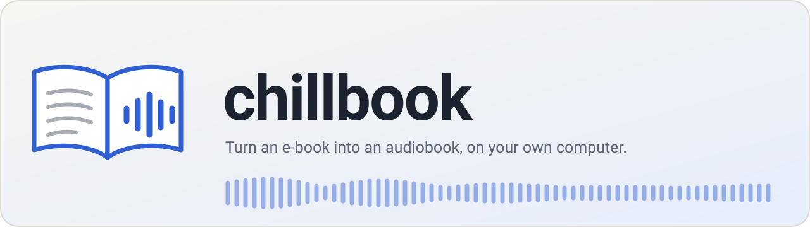
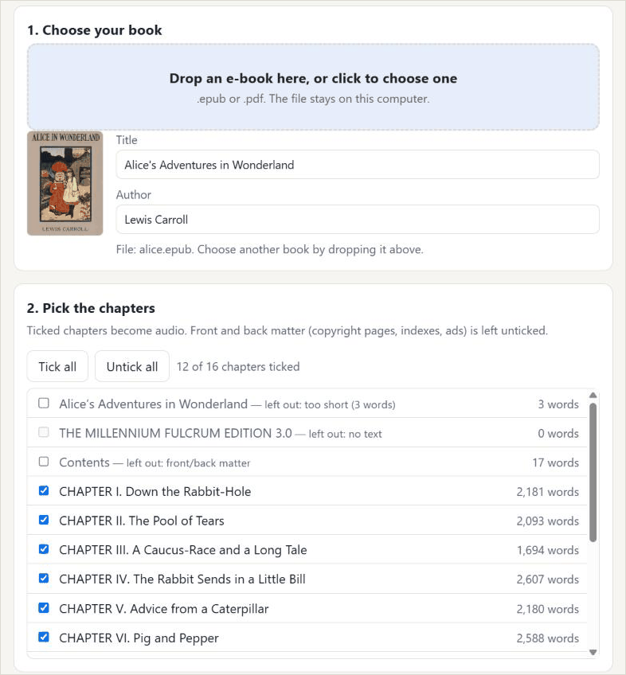
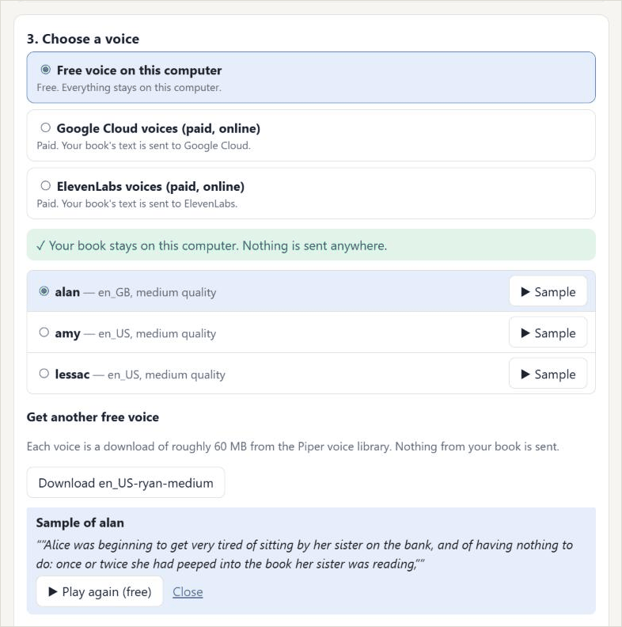
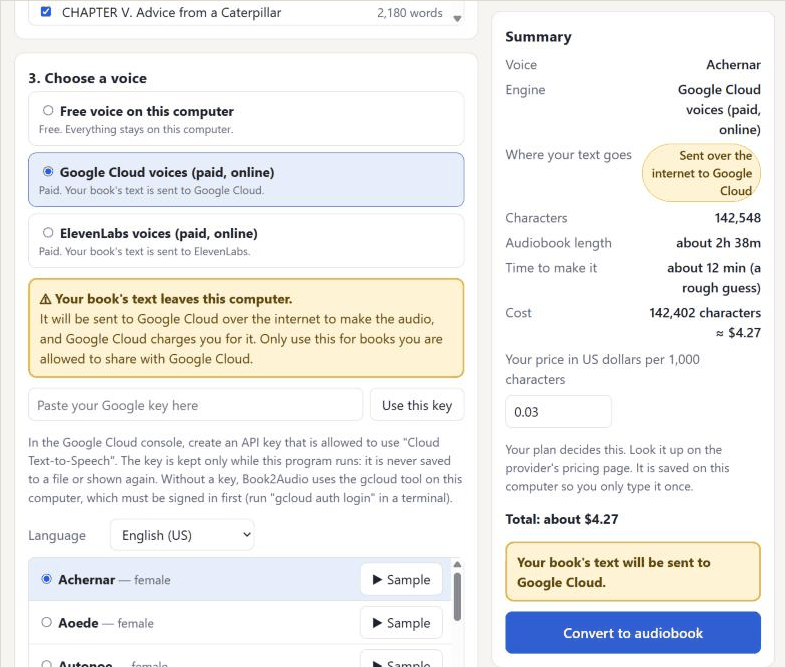
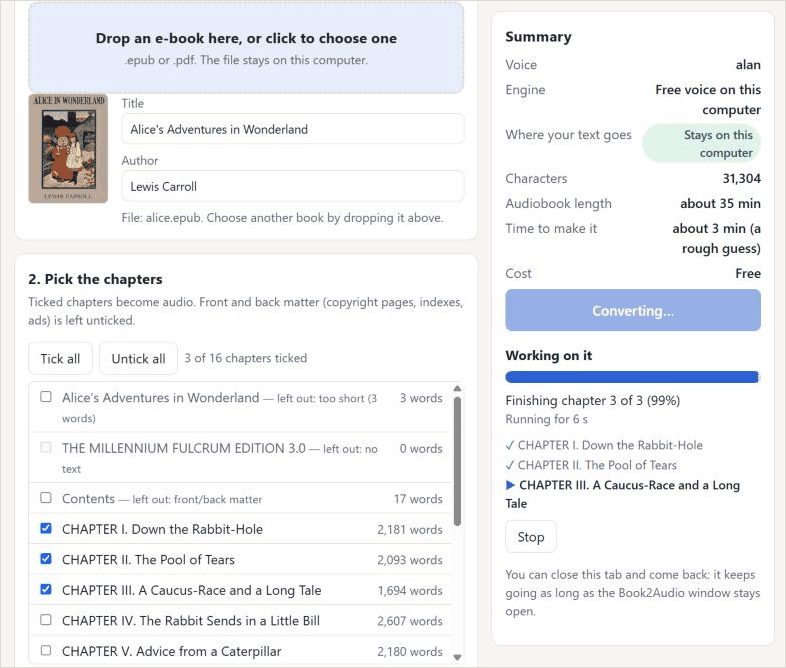

<p align="center">
  <picture>
    <source media="(prefers-color-scheme: dark)" srcset=".github/readme/banner-dark.svg">
    
  </picture>
</p>

<p align="center">
  <a href="LICENSE"></a>
  
  
</p>

**Turn an e-book into an audiobook, on your own computer.** Drop in an `.epub` or `.pdf`, pick the chapters and a voice, hear a sample from your own book, see what it will cost, and press **Convert**. You get one `.m4b` file with a marker for each chapter, the book's title, author and cover, and every chapter at the same loudness. Play it in any audiobook app.

The program is called **book2audio**. This repository, chillbook, is a fork of [Claudemy](https://github.com/assafkip/claudemy) that adds it (see [Credits](#credits-and-licence)).

> [!WARNING]
> **With a cloud voice, your book's text leaves your computer.** ElevenLabs, Google Cloud and the optional Claude clean-up (Anthropic) receive the full text to do their work, and they charge for it. Only use them for books you are allowed to send, and check each provider's terms.
>
> Piper and the macOS voices run on your computer and send nothing. API keys are typed into the page and kept in memory only: never saved to a file, and gone when you close the program.

## See it

The real page, step by step.

**1. Drop in a book.** The chapters come from the book's table of contents. Copyright pages, contents and indexes are left out for you, with the reason.



**2. Hear a voice on your own book.** Every voice has a Sample button that reads the start of your book. Free voices play at once.



**3. See where the text goes, and what it costs.** A cloud voice shows a boxed notice. The summary says where the text goes, and shows the cost once you have typed your price.



**4. Convert, stop, continue.** Progress is shown per chapter. Stop at any time and carry on later: finished parts are never made, or paid for, twice.



<sub>The screenshots show the real page, run with stand-in voice engines on *Alice's Adventures in Wonderland* (public domain). Nothing was sent or paid for. The $4.27 comes from an example price typed in for the screenshot ($0.03 per 1,000 characters), not from Google's price list.</sub>

## How it works


The chapters come from the book's table of contents (EPUB) or its bookmarks and headings (PDF). The text is cleaned and made speakable: abbreviations and numbers are spelled out, running headers and footnotes are removed. A voice reads it chunk by chunk, and ffmpeg joins the chunks, evens out the loudness and adds the chapter markers, tags and cover. More detail: [what it does to the text](book2audio/README.md#what-it-does-to-the-text).

## Voices

| Voice | Cost | Where your text goes |
|---|---|---|
| Piper (default) | free | stays on your computer |
| macOS built-in voices | free | stays on your computer |
| ElevenLabs | paid, by your plan | sent to ElevenLabs |
| Google Cloud Chirp 3 HD | paid, per character | sent to Google Cloud |
| Claude clean-up (optional, not a voice) | paid | sent to Anthropic |

No price is built in. You type what your plan charges, once per provider, and the page turns it into a cost for your book. The time shown is a rough guess.

## Get started

<details>
<summary><b>Install it and start the page</b> (needs Python 3.10 or newer and ffmpeg)</summary>

```bash
# Windows: winget install Gyan.FFmpeg     macOS: brew install ffmpeg
git clone https://github.com/gcazzola/chillbook && cd chillbook
pip install ./book2audio
book2audio ui                    # opens the page in your browser
```

Or double-click `book2audio/Start Book2Audio.bat` (Windows) or `book2audio/Start Book2Audio.command` (macOS). The page opens with a **Get ready** checklist that checks ffmpeg, Piper and your keys, and tells you what is missing.

</details>

<details>
<summary><b>Windows without installing anything</b> (portable zip)</summary>

`book2audio/packaging/` builds one zip with its own Python and ffmpeg (an LGPL build). Unzip it and double-click `Start Book2Audio.bat`. It is not published as a download yet, and it has not been tried on a clean PC. [How to build it, and what is in it](book2audio/packaging/README.md).

</details>

<details>
<summary><b>Command line</b></summary>

```bash
book2audio mybook.epub --dry-run     # chapters, size, time and cost; spends nothing
book2audio mybook.epub               # free local voice (Piper); writes mybook.m4b
```

Start with `--dry-run`. All options (`--backend`, `--voice`, `--chapters`, `--price-per-1k`, `--llm` and more), resuming a run, limits and the tests are in [book2audio/README.md](book2audio/README.md).

</details>

<details>
<summary><b>Safety</b></summary>

The page is served only to your own computer (127.0.0.1, on a free port). Every request must carry a random code created at start-up, and requests from other websites are refused, so a web page you happen to visit cannot start a paid job. Nothing is hosted anywhere.

</details>

## Where it stands

Built and tested with fake voice engines and mocks, using a public-domain book. Tried live so far: short Google Chirp 3 HD and ElevenLabs samples. Not yet tried live: Piper, a full paid chapter, the Claude clean-up, macOS (the launcher and the built-in voices), and a clean Windows PC for the portable zip. English only for now.

## Credits and licence

MIT; see [LICENSE](LICENSE), which keeps Assaf Kipnis's copyright notice and adds this fork's.

book2audio started from [Claudemy](https://github.com/assafkip/claudemy), Assaf Kipnis's skill that turns a topic into short audio lessons: its ElevenLabs request style and its ffmpeg concat and loudness step were adapted, and both are marked in the code. Everything else in `book2audio/` is new. Claudemy itself is untouched in `skills/claudemy/`, and its original README is kept in [CLAUDEMY.md](CLAUDEMY.md). To get Claudemy as its author ships it, use [the original repository](https://github.com/assafkip/claudemy).

Libraries were chosen to keep this project MIT: the GPL and AGPL ones (Piper, `ebooklib`, PyMuPDF) are either run as a separate program or not used.
